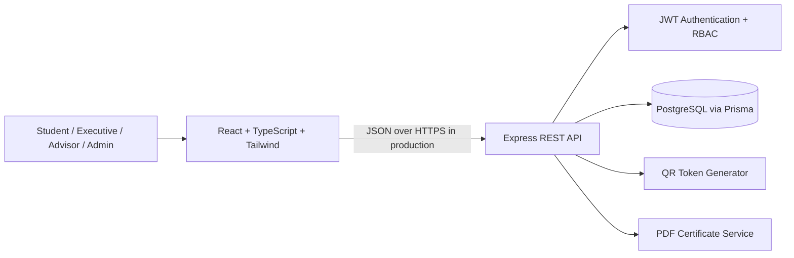

# Architecture and Design

## Selected architecture
CampusConnect uses a three-tier architecture: React/TypeScript client, Express REST API, and PostgreSQL. The API is the trust boundary: all role and resource-scope checks are performed server-side. The client never connects directly to the database.

## Request flow
1. User submits credentials to `POST /api/auth/login`.
2. Server verifies password hash and returns a signed JWT.
3. Client sends the token in the Authorization header for protected endpoints.
4. Authentication middleware verifies signature and account status.
5. Route authorization checks role and resource ownership.
6. Zod validates input; Prisma persists data with database constraints.
7. API returns JSON or a generated PDF response.

## Roles
- `STUDENT`: browse published events/clubs, register, request club membership, view own records/certificates.
- `CLUB_EXECUTIVE`: manage assigned club events, membership requests, announcements and attendance.
- `FACULTY_ADVISOR`: review event proposals for assigned clubs and access scoped reports.
- `ADMIN`: platform-level user/club/event management and reports.

## Event lifecycle
`DRAFT → SUBMITTED → APPROVED → PUBLISHED → COMPLETED` with alternate `REJECTED`, `CHANGES_REQUESTED`, and `CANCELLED` states. Public discovery exposes published events only.

## Design decisions
- PostgreSQL was selected from the SRS alternatives because foreign keys, unique constraints and transactions suit registrations and attendance.
- Passwords use bcrypt hashes; plain-text passwords are never stored.
- QR values are random tokens and should be treated as bearer identifiers. Avoid embedding personal data in QR codes.
- Dates are stored as database timestamps; production deployments should use UTC and display the university's local timezone.
